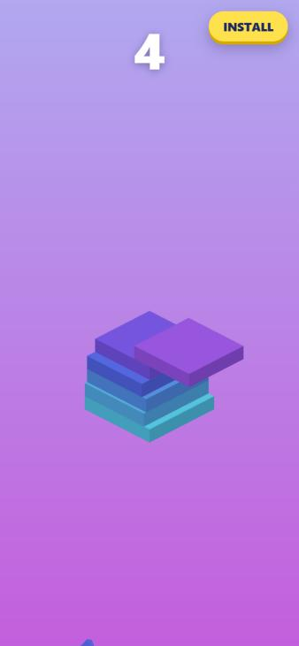

# three-playable-ad

[](https://github.com/Nain9Dev/three-playable-ad/actions/workflows/ci.yml)
[](https://www.naindev.com/three-playable-ad/)
[](https://www.typescriptlang.org/)
[](LICENSE)

A playable ad for mobile games: **one HTML file, about 530 KB, Three.js, no external requests.** It ships with a validator that checks the build against ad-network rules and **fails closed**.

**Play it: https://www.naindev.com/three-playable-ad/** (best on a phone)



## The ad

*Stack Tower*: tap to drop a swinging block on the tower. Overhang is cut off and falls away, a perfect drop snaps and rings out, and a streak of perfect drops grows the block back. After 14 blocks, a miss, or 45 seconds, an end card shows the install button.

Made for the first five seconds: the game starts at once, the hint pulses, the first tap pays off with sound, motion and a score.

| Game feel | How |
| :--- | :--- |
| Landing squash | Damped cosine on the block height |
| Perfect ring | Expanding, fading ring at the block top |
| Debris | Cut-off part falls with gravity and spin |
| Miss | Camera shake and a low thud |
| Win | Confetti burst and a four-note fanfare |
| Sound | Web Audio synthesis, so 0 bytes of audio. The context only starts on the first tap, because networks require the ad to stay muted until the player interacts |

## Network spec, enforced by `npm run validate`

The rules come from public network specs (AppLovin: one HTML file under 5 MB and MRAID 2.0. Meta: a single HTML file under 2 MB).

| Rule | Severity |
| :--- | :--- |
| File under 5 MB | error |
| File under 2 MB | warning |
| No external script, stylesheet, image or iframe | error |
| No `fetch`, `XMLHttpRequest`, `WebSocket` or beacon | error |
| Waits for MRAID `ready` and `viewableChange` | error |
| Store opens with `mraid.open`, never by redirect | error |
| Viewport meta tag present | error |
| Complete HTML document | error |

The validator is a pure function (`src/qa/validate.ts`): same file in, same verdict out. A rule that cannot run counts as a failure. The CLI prints the SHA-256 of the file, so a build can be compared byte for byte.

```text
$ npm run validate
PASS  size-hard          File is under 5 MB (AppLovin limit) (544883 bytes)
PASS  no-network-calls   No fetch or XMLHttpRequest calls (none found)
...
VERDICT: PASS
```

**It caught a real bug on the first build.** Vite injects a module-preload polyfill that calls `fetch()`. The validator failed the build, and `build.modulePreload: false` fixed it. `--json` prints the full report for CI.

## MRAID

`src/ad/sdk.ts` is a small MRAID 2.0 adapter: it starts the ad once the network reports `ready` and the ad is viewable, pauses when the ad is hidden, and opens the store through `mraid.open`. Outside a network (a normal browser) it starts at once and opens the store in a new tab. Tested with a fake MRAID host.

## Stack

TypeScript (strict), Three.js with named imports (tree-shaken), Vite with `vite-plugin-singlefile`, Vitest. No game engine, no runtime assets.

## Commands

```bash
npm install
npm run dev        # local dev server
npm run check      # typecheck, 34 tests, build and validate
npm run validate -- --json   # machine-readable report
```

Requires Node 22.18 or later (the validator CLI runs TypeScript directly).

## Layout

```text
src/game/stack.ts    Pure rules: overlap, cut, perfect, combo. No DOM, no timers
src/render/view.ts   Everything Three.js: scene, camera, debris, rings, shake
src/ad/sdk.ts        MRAID 2.0 adapter
src/audio.ts         Synthesized sound
src/qa/validate.ts   Fail-closed spec validator (pure function)
scripts/validate.ts  Validator CLI
tests/               Rules, MRAID adapter and validator
```

## Make it yours

- Set the install link in `src/config.ts` (`CTA_URL`).
- The rules in `src/game/stack.ts` and the visuals in `src/render/view.ts` are independent, so a new mechanic only needs a new rules module and a view.

Related: [Orbe Runner 3D](https://github.com/Nain9Dev/orbe-runner-3d), a zero-engine Three.js arcade runner with synthesized sound and procedural levels.

## License

MIT
